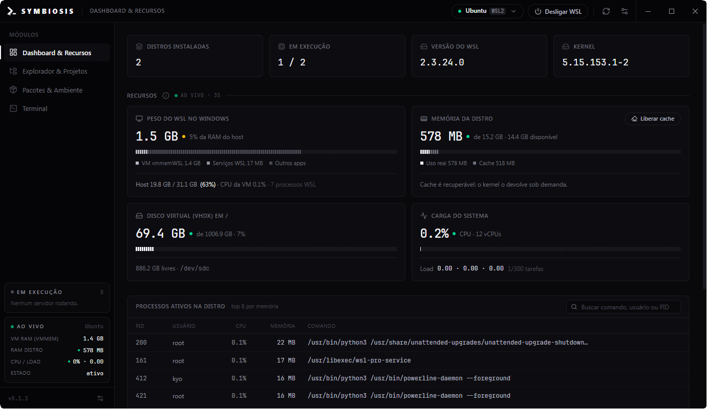
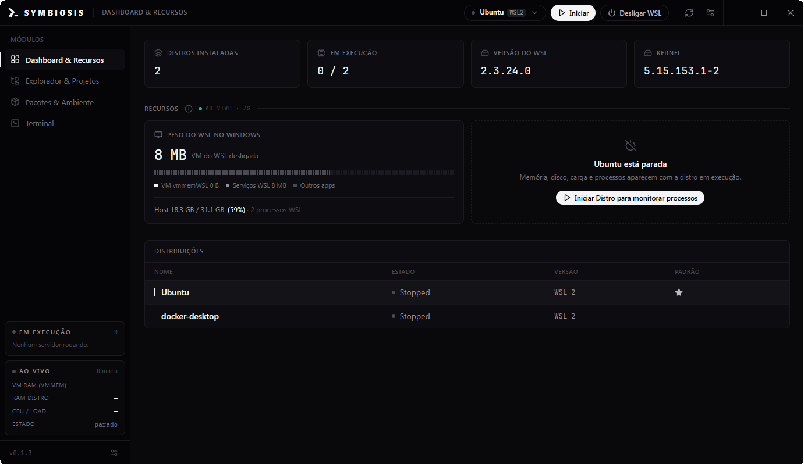
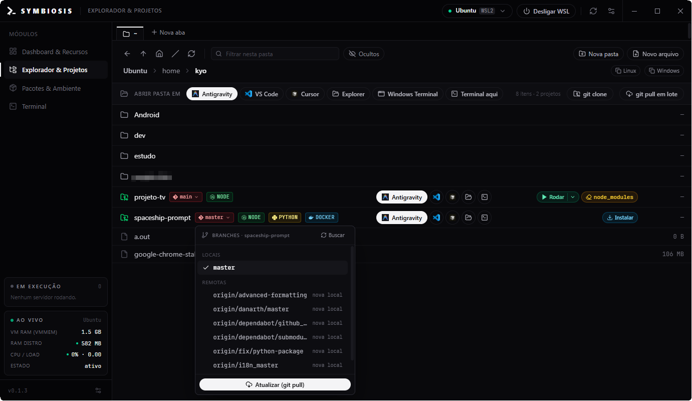
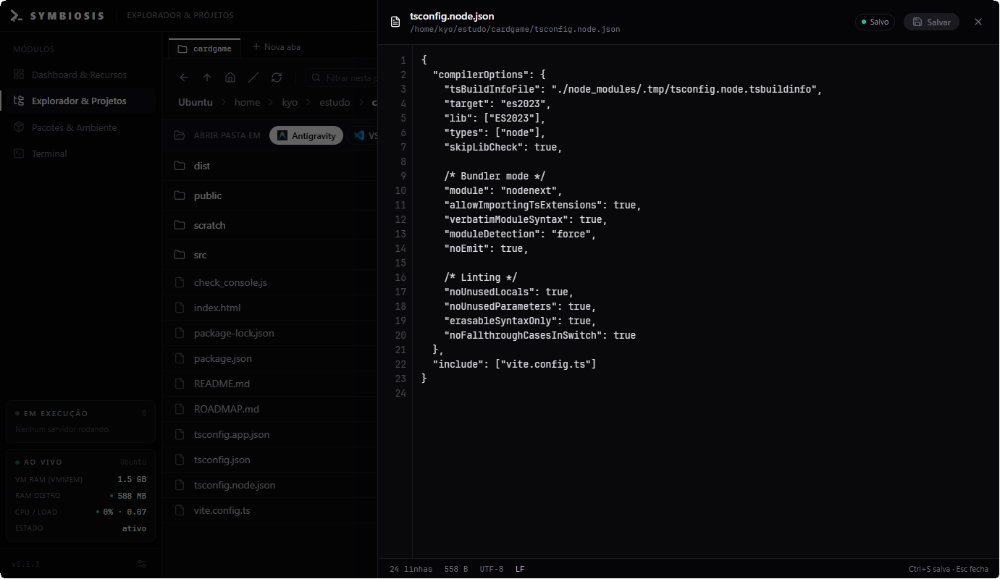
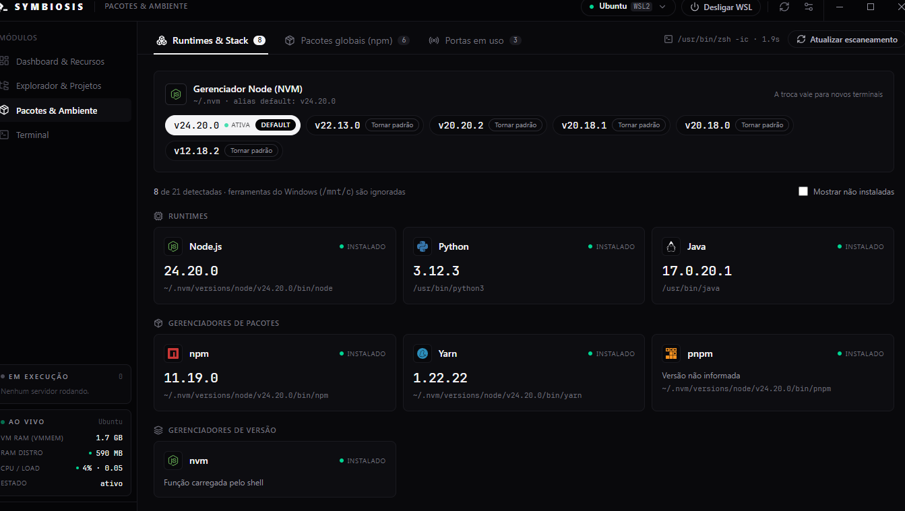
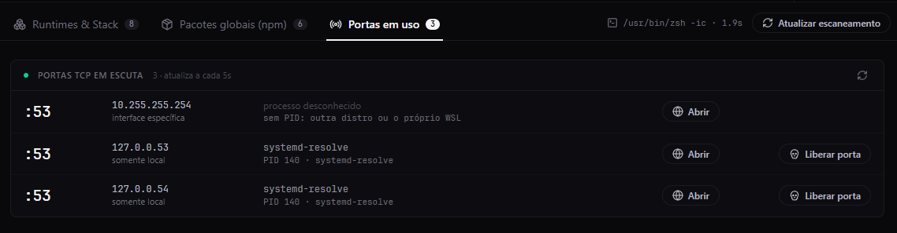
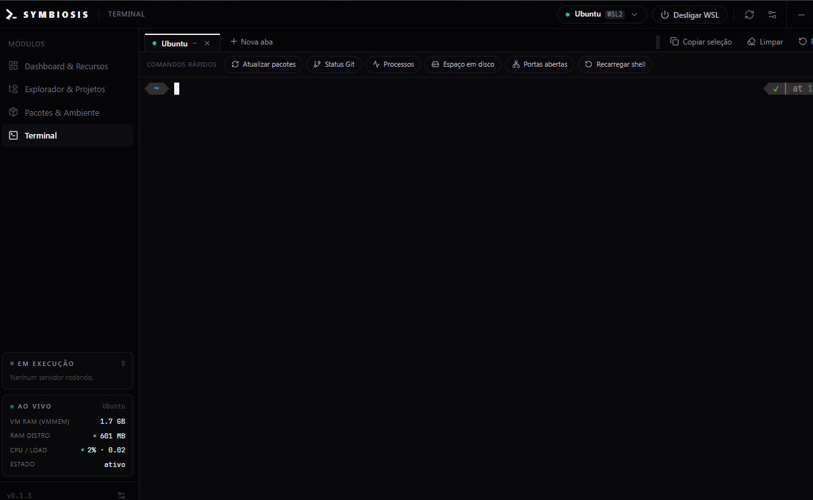

<p align="center">
  <picture>
    <source media="(prefers-color-scheme: dark)" srcset=".github/readme/banner-dark.svg" />
    
  </picture>
</p>

<p align="center">
  <strong>O painel de controle nativo do Windows para quem desenvolve no WSL2.</strong><br />
  Monitore a VM, navegue pelos seus projetos, rode, troque de branch e abra tudo na sua IDE,
  sem decorar comandos e sem sair do Windows.
</p>

<p align="center">
  <a href="https://github.com/consolelogkyo/wsl-symbiosis/releases/latest"></a>
  
  
  
</p>

<p align="center">
  <a href="https://github.com/consolelogkyo/wsl-symbiosis/releases/latest"><strong>⬇ Baixar para Windows</strong></a>
</p>

<p align="center">
  
</p>

---

## Por que existe

Quem desenvolve no WSL2 vive alternando entre o Windows e o Linux: o Gerenciador de Tarefas não
diz quanto o WSL está consumindo, os projetos ficam escondidos em `\\wsl.localhost`, e cada
`npm run dev`, `git switch` ou `nvm use` pede um terminal aberto.

O **WSL Symbiosis** junta tudo isso numa janela só, com cara de app nativo: leve (instalador de
~3 MB), rápido e que funciona offline.

## O que ele faz

### Dashboard & Recursos

Raio-x da VM em tempo real: quanto o WSL pesa de verdade no Windows (a memória do `vmmemWSL`, a
mesma do Gerenciador de Tarefas), memória e cache da distro, disco virtual (VHDX), carga de CPU
e os processos que mais consomem, com busca e **encerrar processo** num clique.

- **Liberar cache** devolve ao Windows a memória que o Linux guardou como cache.
- Iniciar e **desligar o WSL** (`wsl --shutdown`) direto da barra superior.
- Com a distro parada, o app não a liga sozinho só para medir: ela fica parada até você pedir.

<p align="center">
  
</p>

### Explorador & Projetos

Um explorador de arquivos da sua distro feito para projetos:

- **Abas**, como num navegador (Ctrl+T, Ctrl+W, Ctrl+Tab; os atalhos são configuráveis).
- **Abrir em** Antigravity, VS Code ou Cursor (via `--remote wsl+`), no Explorer do Windows, no
  Windows Terminal ou no terminal do próprio app.
- Detecta a stack de cada projeto (Node, Python, Docker, Rust, Go…) e mostra a **branch do git**
  na linha.
- **Rodar / Parar** o script do projeto (`dev`, `start`…) com o gerenciador certo (npm, pnpm,
  yarn, bun) e o Node do seu nvm; instalar ou limpar `node_modules`.
- **Git sem terminal:** trocar de branch, `fetch`, **git pull em lote** (vários repositórios em
  fila, sempre `--ff-only`, sem criar merge nem conflito) e **git clone** de um link HTTPS ou SSH.
  Se o HTTPS pedir senha, o app tenta de novo via SSH com a sua chave.

<p align="center">
  
</p>

Arquivos de texto abrem num **editor embutido** (Ctrl+S salva), para aquele ajuste rápido sem
abrir a IDE:

<p align="center">
  
</p>

### Pacotes & Ambiente

- **Runtimes & Stack:** Node, Python, Java, Go, Rust, Docker, npm, Yarn, pnpm, Bun… detectados no
  **shell real** do seu usuário (zsh ou bash, com o que o seu `.zshrc` carrega), ignorando as
  ferramentas do Windows que vazam pelo `/mnt/c`.
- **NVM:** veja as versões instaladas e troque a versão padrão com um clique.
- **Pacotes globais do npm:** instale e remova.

<p align="center">
  
</p>

- **Portas em uso:** o que está escutando na distro, de qual processo e pasta, com **Abrir** no
  navegador e **Liberar porta**.

<p align="center">
  
</p>

### Terminal

Terminal de verdade (ConPTY + xterm.js) com abas, o seu shell e o seu tema, e **comandos rápidos**
(atualizar pacotes, status do git, processos, espaço em disco, portas abertas).

<p align="center">
  
</p>

### Setup Zero-to-Hero

No primeiro acesso o app faz um diagnóstico da máquina e monta o ambiente para você. Cada item é
opcional e seguro de repetir: o que já existe é mantido, e os arquivos alterados ganham backup.

- **Sem WSL?** Habilita o WSL2 (pede permissão de administrador uma vez) e continua depois do
  reinício.
- **Sem Linux?** Instala o Ubuntu: você escolhe usuário e senha na própria tela, sem Microsoft
  Store. Só tem o Docker Desktop? O app reconhece que as distros dele não servem para desenvolver.
- **Ambiente:** Windows Terminal com o Ubuntu como padrão e o tema Dracula, Zsh + Oh-My-Zsh, tema
  Spaceship, plugins (autosuggestions, syntax highlighting, completions) e NVM + Node.js LTS.
- **IDE favorita:** Antigravity, VS Code ou Cursor; se não tiver nenhuma, o app mostra onde baixar.

### Atualizações automáticas

O app avisa quando sai uma versão nova (**Atualizar para vX.Y.Z** na barra superior), mostra as
novidades, baixa, instala e reabre sozinho. Os pacotes são **assinados**: o app recusa qualquer
atualização que não tenha sido gerada por este projeto.

## Download e instalação

1. Baixe o `WSL-Symbiosis_x.y.z_x64-setup.exe` da **[última versão](https://github.com/consolelogkyo/wsl-symbiosis/releases/latest)**.
2. Execute o instalador. Ele instala só para o seu usuário, sem precisar de administrador.
3. Abra o **WSL Symbiosis**: o setup inicial cuida do resto.

> **"O Windows protegeu o computador"?** O instalador ainda não tem certificado de assinatura de
> código pago, então o SmartScreen avisa na primeira vez. Clique em **Mais informações →
> Executar assim mesmo**. As atualizações seguintes chegam pelo próprio app.

**Requisitos:** Windows 10 (versão 2004 ou mais recente) ou Windows 11, 64 bits, com virtualização
habilitada na BIOS (necessária para o WSL2). O WebView2 já vem no Windows 11; no Windows 10 o
instalador baixa se faltar.

## Privacidade

- Sem telemetria e sem conta: nada sai da sua máquina.
- O app funciona offline. Só acessa a internet para procurar atualizações (no GitHub) e quando
  **você** pede algo que precisa de rede: git pull/clone, instalar pacotes, rodar o setup.
- Ícones e logos vêm embutidos no app; nada é baixado para desenhar a interface.

## Para desenvolvedores

Feito com **Tauri v2** (Rust) + **React 19**, **TypeScript**, **Vite** e **Tailwind CSS v4**.

```bash
npm install
npm run tauri dev
```

Requer [Rust](https://rustup.rs/), Node.js 20+ e os
[pré-requisitos do Tauri para Windows](https://v2.tauri.app/start/prerequisites/). As regras do
projeto (como falar com o `wsl.exe` sem piscar janelas, encoding UTF-16, scripts que rodam igual
em zsh e sh, etc.) estão em [`CLAUDE.md`](CLAUDE.md).

---

<p align="center">
  <sub>Feito por <a href="https://github.com/consolelogkyo">@consolelogkyo</a> · Windows ⇄ WSL2</sub>
</p>
